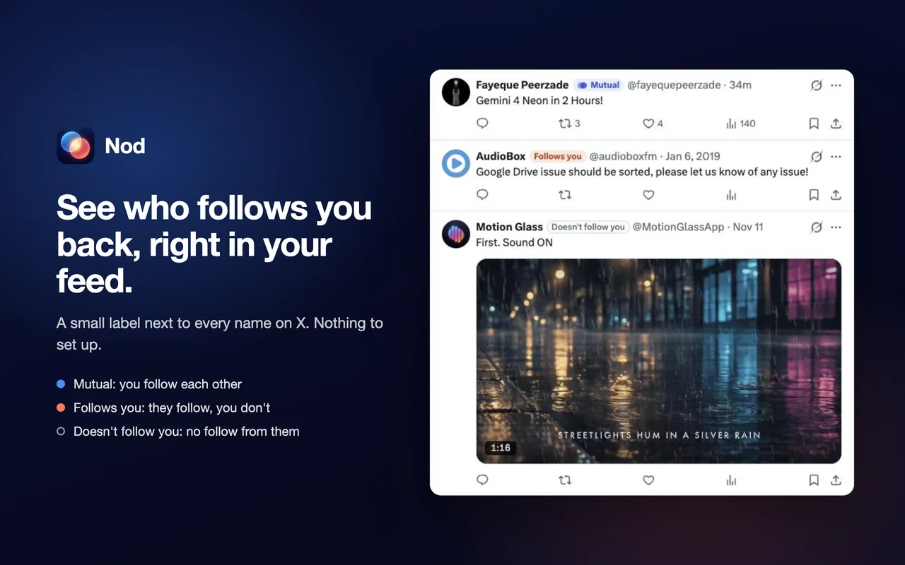
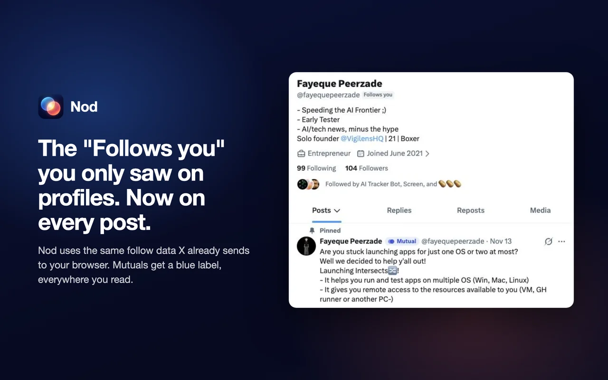
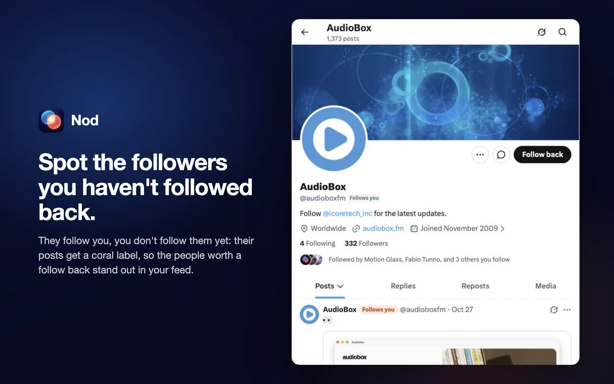
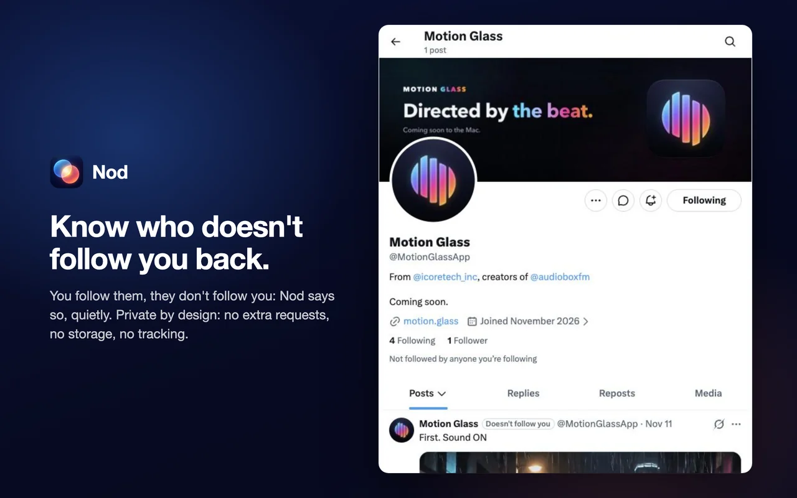

# Nod


Nod shows who follows you on X. It adds a small label beside the author's name
on posts in your timeline, replies, search results, and profile feeds. It runs
in Chrome and other Chromium browsers, and in Firefox on desktop and Android.



| Label | What it means |
| --- | --- |
| **Mutual** | You follow each other. |
| **Follows you** | The author follows you. You don't follow them. |
| **Doesn't follow you** | The author doesn't follow you. |

On desktop, hover over **Doesn't follow you** to see whether you follow the
author.
Your own posts stay unlabeled, as do posts where X hasn't supplied a follow
status. Labels follow X's light, dim, and dark themes and use English or Italian
according to your X language setting.

<details>
<summary>More screenshots</summary>







</details>

## Download a release

Get the [latest release](https://github.com/icoretech/nod/releases/latest).
On Firefox for Android, install Nod from addons.mozilla.org: Android accepts
only Mozilla-signed extensions from the store. Each release includes standalone
downloads:

- **[Unsigned Firefox ZIP](https://github.com/icoretech/nod/releases/latest/download/nod-firefox-unsigned.zip)**
  — in a LibreWolf profile that accepts unsigned add-ons
  (`xpinstall.signatures.required` set to `false` in `about:config`), open
  `about:addons`, click the gear, choose **Install Add-on From File**, and
  select the downloaded ZIP directly. It stays installed after a restart.
  Standard Firefox requires the Mozilla-signed `nod-firefox.xpi`, attached to a
  release once Mozilla approves it. To test the unsigned ZIP there, open
  `about:debugging#/runtime/this-firefox` and select the ZIP with
  **Load Temporary Add-on**.
- **[Chrome ZIP](https://github.com/icoretech/nod/releases/latest/download/nod-chrome.zip)**
  — extract the archive to a folder you will keep. In Chrome's extensions page,
  enable **Developer mode**, choose **Load unpacked**, and select that folder.
- **[Reviewer source](https://github.com/icoretech/nod/releases/latest/download/nod-review-source.zip)**
  — rebuild the extension with the instructions below. To verify the downloads,
  put all three ZIPs and the release's `SHA256SUMS` in the same directory and
  run `shasum -a 256 -c SHA256SUMS`.

## Install from source

From the repository root, use Node.js 24 or newer and npm:

```sh
npm ci
npm run build
```

1. Open `about:debugging#/runtime/this-firefox`.
2. Click **Load Temporary Add-on…** and select `dist/firefox/manifest.json`.
3. Open or reload an x.com tab while signed in to see the labels.

A temporary add-on stays loaded until the browser restarts. After rebuilding,
click **Reload** next to it on the same page.

To keep it installed across restarts, package it and install the ZIP:

```sh
npm run package
```

In a LibreWolf profile that accepts unsigned add-ons
(`xpinstall.signatures.required` set to `false` in `about:config`), open
`about:addons`, click the gear, choose **Install Add-on From File**, and select
the ZIP in `artifacts/firefox/`. It stays installed after a restart. To update,
build and install again the same way. Standard Firefox keeps only
Mozilla-signed add-ons installed, so use the temporary installation there.

**Firefox for Android:** the Firefox package also declares Android support
(`gecko_android`, Firefox 142 or newer). To try a build on a phone or emulator
with Firefox installed, enable **Remote debugging via USB** in Firefox's
settings, connect the device over `adb`, and run:

```sh
npx web-ext run --source-dir dist/firefox --target firefox-android \
  --android-device <adb device id> --firefox-apk org.mozilla.firefox
```

Use `org.mozilla.firefox_beta` or `org.mozilla.fenix` for Beta or Nightly.

**Chrome, Brave, Edge, or Arc:** open the browser's extensions page, enable
**Developer mode**, choose **Load unpacked**, and select `dist/chrome/`.

## How it works

X includes follow relationships in the data it sends to your browser. Nod reads
the `followed_by` and `following` fields from those responses, or from a
rendered post when the response was missed. It keeps the relationships in memory
for the current tab and updates the labels as you scroll.

The extension runs only on `https://x.com/*`. It makes no network requests of
its own and has no accounts, analytics, or persistent storage.
[Privacy policy](https://icorete.ch/nod/privacy/)

## Development

```sh
npm test
npm run biome:ci
npm run package
npm run web-ext:lint
```

`npm run biome:ci` checks formatting, lint, and TypeScript. `npm run package`
builds both browsers and writes their ZIPs to `artifacts/chrome/` and
`artifacts/firefox/`. `scripts/make-icons.sh` rebuilds the icons from
`assets/brand/logo-source.png` (requires ImageMagick 7).

If X changes its markup or data format, start with the
[author selectors](src/x/selectors.ts),
[relationship parser](src/core/relationships.ts),
[network observer](src/x/network-tap.ts), or
[rendered-post fallback](src/x/react-props.ts).

## Releases

CI runs on pull requests and pushes to `main` using GitHub-hosted Linux runners.
Merging the release-please version PR creates a version tag and a draft
release. The release workflow checks out that tag, runs the tests, builds and
validates the packages, and publishes the draft with its downloads. To retry
an interrupted draft, run the **Release** workflow on `main` with its tag.
Dependency updates alone don't start a release: they ship with the next
feature or fix.

After publishing, the release workflow runs **Submit to stores**, which sends
the published packages to the Chrome Web Store and addons.mozilla.org for
review. To retry one store, run **Submit to stores** on `main` with the tag.

### Store submission

Each store job is skipped until its repository settings exist:

| Store | Variables | Secrets |
| --- | --- | --- |
| Chrome Web Store | `GCP_WORKLOAD_IDENTITY_PROVIDER`, `CWS_SERVICE_ACCOUNT` | none |
| addons.mozilla.org | `AMO_SUBMIT` set to `true` | `AMO_API_KEY`, `AMO_API_SECRET` |

The Chrome job signs in with GitHub's OIDC token through Workload Identity
Federation, so no Google key is stored. The service account must be the one
added under **Account** in the Chrome Web Store dashboard. The Firefox job uses
the AMO API credentials, takes the license and reviewer notes from
`store/amo-metadata.json`, uses the GitHub release notes as the version notes,
and uploads the release's source archive. The `gecko_android` entry in
`manifest/firefox.json` is what lists a version for Firefox for Android as well
as desktop; no separate upload or setting is needed. Listing text and images
are edited in each store's dashboard.

To check the credentials without uploading anything, run **Check store access**
on `main`. It reads the Chrome Web Store item status and the AMO account.

Once Mozilla approves a listed version, **Attach signed Firefox XPI** adds
Mozilla's signed XPI to the release. It runs daily for recent releases that
don't have one yet; run it on `main` with a tag to attach one sooner. It verifies
Mozilla's SHA-256 digest and compares the extension contents with the published
Firefox ZIP before attaching the XPI.

## Build for AMO reviewers

From the source archive root, run `npm ci` followed by `npm run build` with
Node.js 24 or newer. The lockfile pins the dependencies. Vite produces an
unminified `content.js`, and the build assembles the Firefox manifest, script,
stylesheet, and icons in `dist/firefox/`. `npm run package:review-source`
creates that archive from this repository.

## License

[MIT](LICENSE). Nod is an independent project and is unaffiliated with X Corp.
